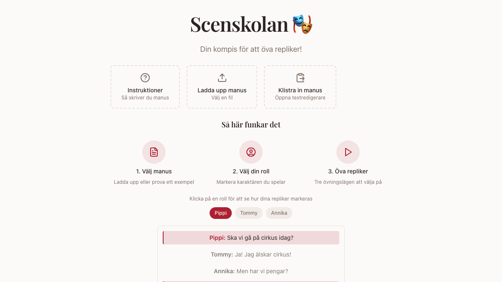

# Scenskolan 🏫

Scenskolan är en kompis för unga skådespelare som ska lära sig sina repliker. Ladda upp
eller klistra in ett manus, välj din roll och öva med bara dina repliker, med stickorden
före dem eller med hela manuset.

**Spela:** https://scenskolan.skolappar.org · En del av [Skolappar](https://www.skolappar.org) – pedagogiska appar av föräldrar · öppen källkod (MIT)



Körs fristående.

## Vad du kan göra

- **Välj manus**: ladda upp en `.txt`-fil, klistra in text eller prova ett av nio exempelmanus.
- **Välj din roll** bland karaktärerna i manuset.
- **Tre övningslägen**:
  - *Full*: hela manuset med alla repliker.
  - *Stickord*: dina repliker och repliken före varje.
  - *Repliker*: bara dina egna repliker.
- **Scener**: hoppa mellan scenerna i sidomenyn eller visa alla.
- **Uppspelning**: webbläsarens röst läser de synliga replikerna i tur och ordning.
- **Kontroll av manus**: fel och varningar visas innan manuset läses in.
- **Konvertera format**: gör om manuset till ett enkelt eller teaterformat (med eller utan
  rollista och Markdown). Resultatet kan kopieras eller laddas ner.
- **Dela**: kopiera en länk där hela manuset ligger i adressen, så att någon annan kan öppna det.
- **Instruktioner** för hur ett manus ska skrivas: `SCEN 1`, `Pippi: Hej alla!`, `(springer in)`.
- Kan installeras som app på mobilen eller surfplattan (PWA).

## Kom igång

```bash
npm install
npm run dev        # utvecklingsserver på port 8080
npm run build      # produktionsbygge till dist/
npm run build:dev  # bygge i utvecklingsläge
npm run preview    # förhandsgranska bygget
npm run lint       # eslint
```

Repot har ingen Dockerfile. `dist/` är en statisk sajt som kan läggas på valfri webbserver.

## Integritet

- Inget konto, ingen inloggning, inga kakor och ingen analys.
- Manus och inställningar sparas bara i `localStorage`:
  - `scenskolan-saved-script`: det senast inlästa manuset
  - `scenskolan-settings`: övningsläge, vald roll och scen
- Delningslänken lägger hela manuset base64-kodat i parametern `?script=` i adressen.
  Den som får länken kan läsa manuset.
- Uppspelningen använder webbläsarens inbyggda talsyntes (`speechSynthesis`).
- Typsnittet Playfair Display hämtas från Google Fonts (`fonts.googleapis.com`). Det är
  appens enda anrop till en extern server. Brödtexten använder systemets typsnitt.

## Struktur

```
src/
  pages/Index.tsx               startsida, val av manus och roll, delning
  components/ScriptDisplay.tsx  manus, övningslägen, uppspelning
  components/AppSidebar.tsx     scener och konvertering
  components/ScriptConverterDialog.tsx   konvertera format
  components/ScriptValidationDialog.tsx  fel och varningar i manuset
  hooks/useScript.ts            inläst manus (localStorage)
  hooks/useSettings.ts          inställningar (localStorage)
  hooks/useScriptPlayback.ts    uppläsning med webbläsarens röst
  utils/scriptParser.ts         tolkar manus till scener, roller och repliker
  utils/scriptValidator.ts      kontrollerar manus
  utils/scriptConverter.ts      byter format
  utils/scriptSharing.ts        delningslänkar
  data/sampleScripts.ts         exempelmanus
vite.config.ts                  Vite och PWA-inställningar
```

## Licens

MIT – se [LICENSE](LICENSE).
